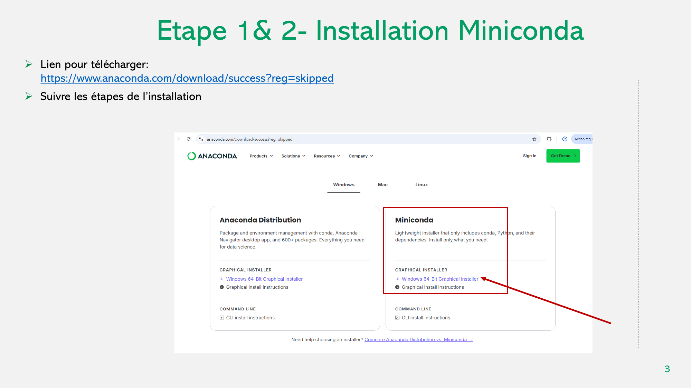
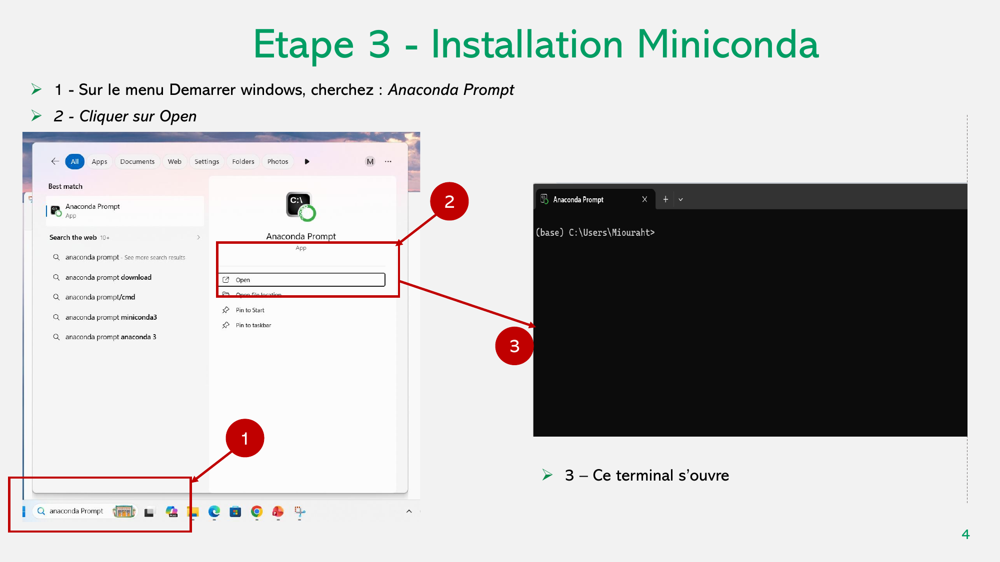
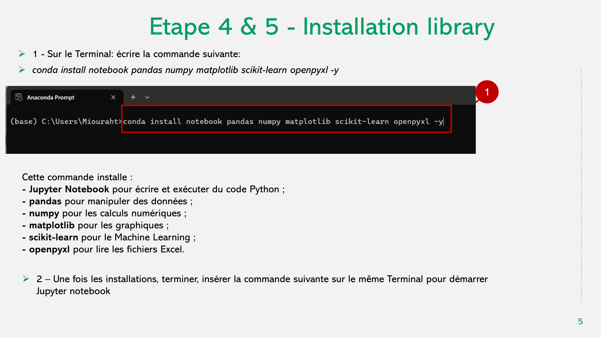
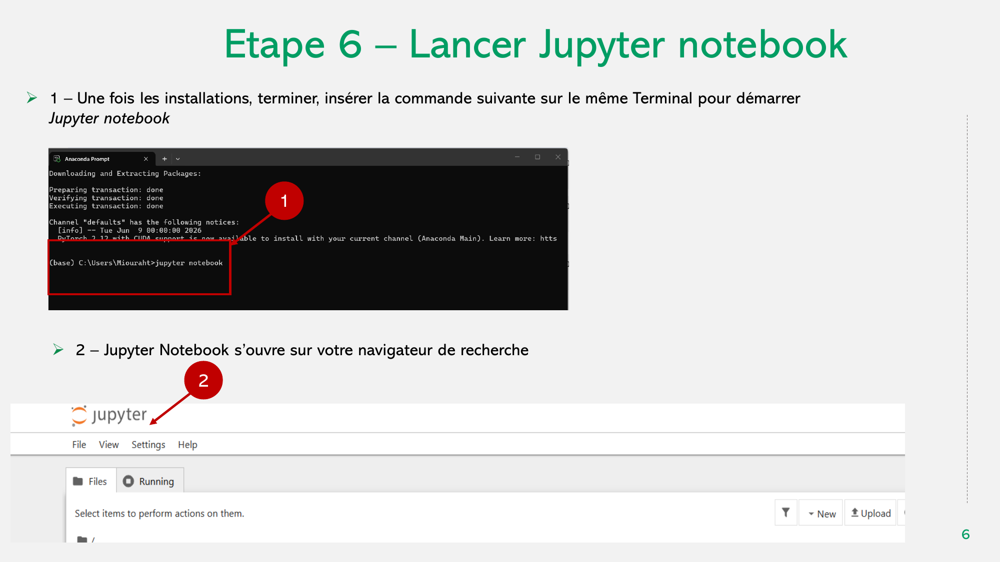
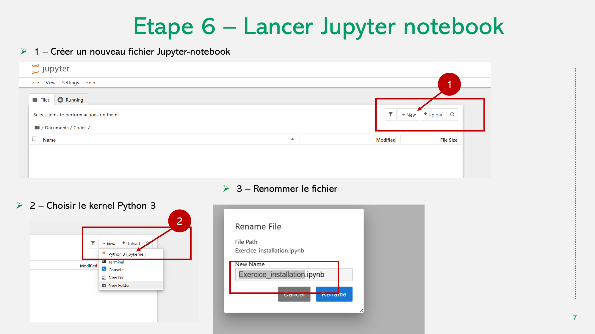
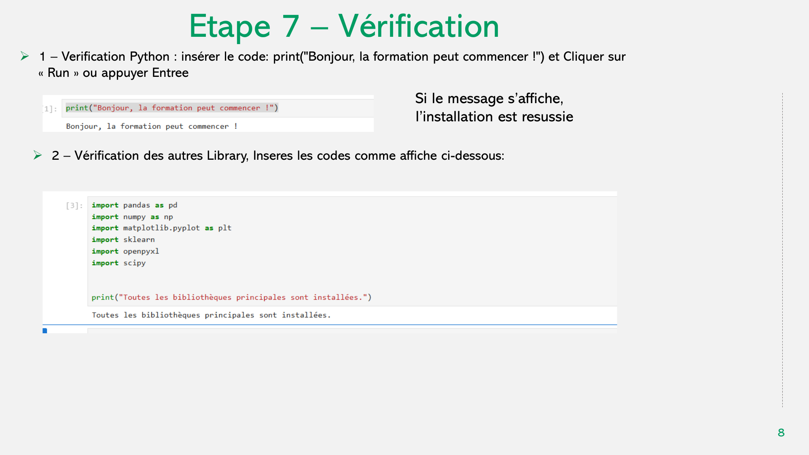

## Objectifs

À la fin de cette partie, vous serez capables de :

- installer **Miniconda** ;
- ouvrir **Anaconda Prompt** ;
- installer **Jupyter Notebook** et les bibliothèques nécessaires ;
- lancer un notebook Python ;
- créer un nouveau fichier Jupyter Notebook ;
- vérifier que l’environnement de travail fonctionne correctement.

---

## Étapes de l’installation

L’installation se déroule en sept étapes :

1. Télécharger Miniconda ;
2. Installer Miniconda ;
3. Ouvrir Anaconda Prompt ;
4. Installer Jupyter Notebook ;
5. Installer les bibliothèques nécessaires ;
6. Lancer Jupyter Notebook ;
7. Vérifier que l’installation fonctionne.

::: {.callout-note}
## Environnement utilisé dans ce cours

Le cours utilise **Python**, **Jupyter Notebook** et plusieurs bibliothèques scientifiques pour l’analyse de données et le Machine Learning.
:::

---

# Étapes 1 et 2 - Installer Miniconda

Télécharger Miniconda depuis le site d’Anaconda :

<https://www.anaconda.com/download/success?reg=skipped>

Choisir l’installateur correspondant à votre système, puis suivre les étapes d’installation.

{fig-alt="Téléchargement et installation de Miniconda" width="95%"}

---

# Étape 3 - Ouvrir Anaconda Prompt

Sous Windows :

1. ouvrir le menu **Démarrer** ;
2. rechercher **Anaconda Prompt** ;
3. cliquer sur **Open / Ouvrir** ;
4. un terminal s’ouvre.

{fig-alt="Ouverture d'Anaconda Prompt sous Windows" width="95%"}

---

# Étapes 4 et 5 - Installer Jupyter Notebook et les bibliothèques

Dans **Anaconda Prompt**, saisir la commande suivante :

```bash
conda install notebook pandas numpy matplotlib scikit-learn openpyxl -y
```

Cette commande installe :

- **Jupyter Notebook** pour écrire et exécuter du code Python ;
- **pandas** pour manipuler des données ;
- **numpy** pour les calculs numériques ;
- **matplotlib** pour créer des graphiques ;
- **scikit-learn** pour le Machine Learning ;
- **openpyxl** pour lire et écrire des fichiers Excel.

{fig-alt="Installation de Jupyter Notebook et des bibliothèques Python" width="95%"}

---

# Étape 6 - Lancer Jupyter Notebook

Une fois l’installation terminée, saisir dans le même terminal :

```bash
jupyter notebook
```

Jupyter Notebook s’ouvre alors dans votre navigateur web.

{fig-alt="Lancement de Jupyter Notebook depuis Anaconda Prompt" width="95%"}

---

## Créer un nouveau notebook

Dans l’interface Jupyter Notebook :

1. cliquer sur **New** ;
2. choisir le kernel **Python 3** ;
3. renommer le fichier, par exemple `Exercice_installation.ipynb`.

{fig-alt="Création et renommage d'un nouveau Jupyter Notebook" width="95%"}

---

# Étape 7 - Vérifier l’installation

## Vérifier Python

Dans une cellule du notebook, saisir :

```{python}
#| eval: false

print("Bonjour, la formation peut commencer !")
```

Cliquer sur **Run** ou exécuter la cellule.

Le résultat attendu est :

```text
Bonjour, la formation peut commencer !
```

Si le message s’affiche, Python fonctionne correctement.

---

## Vérifier les bibliothèques

Dans une nouvelle cellule, saisir :

```{python}
#| eval: false

import pandas as pd
import numpy as np
import matplotlib.pyplot as plt
import sklearn
import openpyxl
import scipy

print("Toutes les bibliothèques principales sont installées.")
```

Le résultat attendu est :

```text
Toutes les bibliothèques principales sont installées.
```

{fig-alt="Vérification de Python et des bibliothèques installées" width="95%"}

::: {.callout-tip}
## Installation réussie

Si les deux tests s’exécutent sans erreur, votre environnement de travail est prêt pour la suite du cours.
:::

---

## Points à retenir

::: {.callout-tip}
## À retenir

- **Miniconda** permet de gérer l’environnement Python et les paquets nécessaires.
- **Anaconda Prompt** permet d’exécuter les commandes d’installation.
- **Jupyter Notebook** permet d’écrire et d’exécuter du code Python de manière interactive.
- Les bibliothèques `pandas`, `numpy`, `matplotlib`, `scikit-learn` et `openpyxl` seront utilisées dans les modules suivants.
- Il est important de vérifier l’installation avant de commencer les exercices.
:::

---

<div class="chapter-nav">

[← IA dans l’agriculture](01-ia-agriculture.qmd){.chapter-prev}

[Variables et types de données →](02-2-variables.qmd){.chapter-next}

</div>
