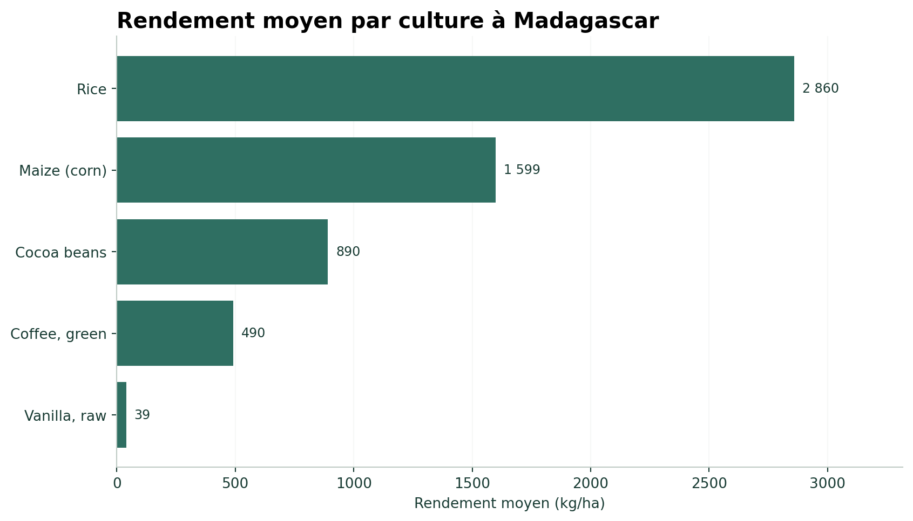
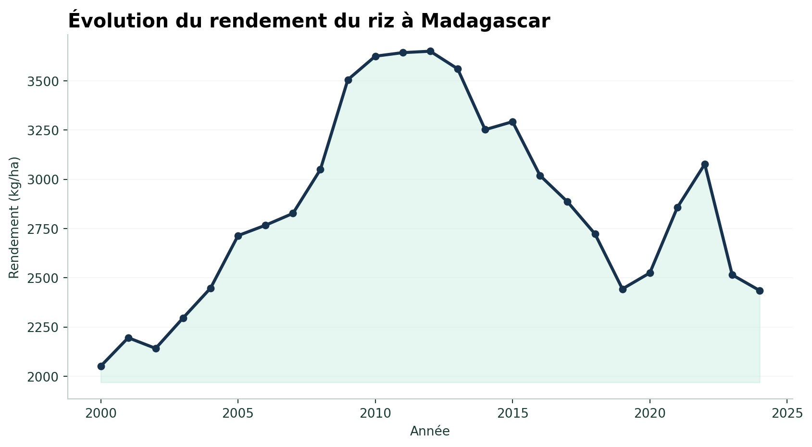
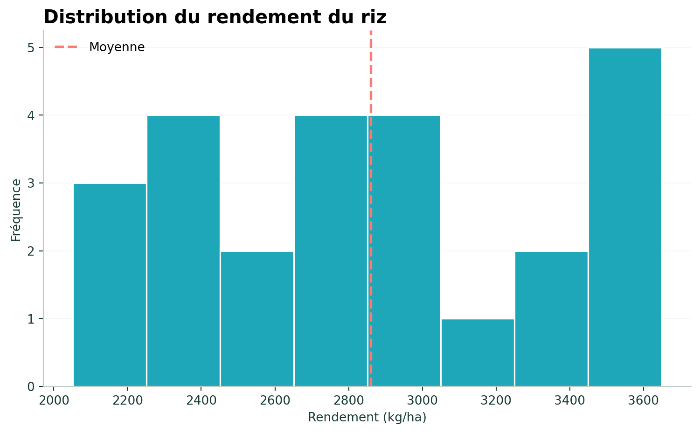
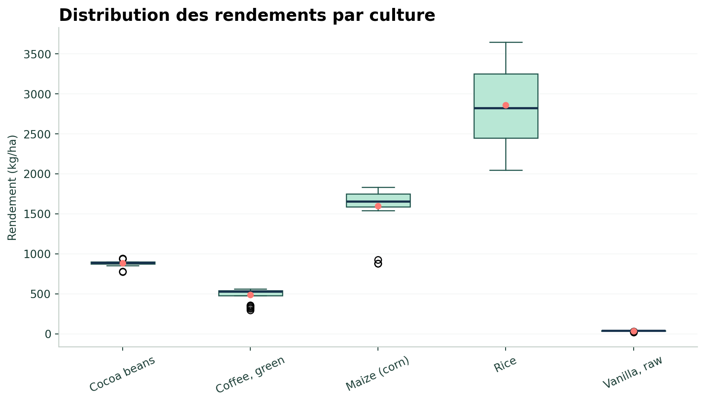

## Personnaliser les graphiques avec Matplotlib

Nous utiliserons une petite palette cohérente avec le site :

```{python}
#| eval: false

import matplotlib.pyplot as plt

GREEN = "#2F6F62"
GREEN_LIGHT = "#B8E7D5"
CORAL = "#FF7973"
NAVY = "#17324D"
TEAL = "#1DA7B8"
INK = "#183B33"
GRID = "#D9E3DE"
```

[Documentation officielle de Matplotlib](https://matplotlib.org/stable/)

## Rendement moyen par culture

Pour améliorer la lisibilité, on peut :

- trier les cultures par rendement ;
- utiliser un graphique horizontal ;
- ajouter les valeurs au bout des barres ;
- supprimer les bordures supérieures et droites ;
- utiliser une couleur cohérente avec le site.

```{python}
#| eval: false

rendement_moyen = (
    table_rendement
    .groupby("Culture")["Valeur"]
    .mean()
    .sort_values()
)

fig, ax = plt.subplots(figsize=(9, 5.2))

barres = ax.barh(
    rendement_moyen.index,
    rendement_moyen.values,
    color=GREEN
)

ax.set_title(
    "Rendement moyen par culture à Madagascar",
    loc="left",
    fontsize=15,
    fontweight="bold"
)

ax.set_xlabel("Rendement moyen (kg/ha)")
ax.set_ylabel("")

ax.spines["top"].set_visible(False)
ax.spines["right"].set_visible(False)

ax.grid(
    axis="x",
    alpha=0.22,
    color=GRID
)

ax.set_axisbelow(True)

for barre, valeur in zip(
    barres,
    rendement_moyen.values
):
    ax.text(
        barre.get_width() + rendement_moyen.max() * 0.012,
        barre.get_y() + barre.get_height() / 2,
        f"{valeur:,.0f}".replace(",", " "),
        va="center",
        fontsize=9,
        color=INK
    )

plt.tight_layout()
plt.show()
```

{fig-alt="Rendement moyen par culture à Madagascar"}

[Documentation Matplotlib — graphiques en barres](https://matplotlib.org/stable/api/_as_gen/matplotlib.pyplot.barh.html)

## Évolution du rendement du riz

```{python}
#| eval: false

riz = table_rendement[
    table_rendement["Culture"] == "Rice"
].sort_values("Annee")

fig, ax = plt.subplots(figsize=(9, 5))

ax.plot(
    riz["Annee"],
    riz["Valeur"],
    color=NAVY,
    linewidth=2.4,
    marker="o",
    markersize=5
)

ax.fill_between(
    riz["Annee"],
    riz["Valeur"],
    riz["Valeur"].min() * 0.96,
    color=GREEN_LIGHT,
    alpha=0.35
)

ax.set_title(
    "Évolution du rendement du riz à Madagascar",
    loc="left",
    fontsize=15,
    fontweight="bold"
)

ax.set_xlabel("Année")
ax.set_ylabel("Rendement (kg/ha)")

ax.spines["top"].set_visible(False)
ax.spines["right"].set_visible(False)
ax.grid(axis="y", alpha=0.25, color=GRID)
ax.set_axisbelow(True)

plt.tight_layout()
plt.show()
```

{fig-alt="Évolution du rendement du riz à Madagascar"}

[Documentation Matplotlib — courbes](https://matplotlib.org/stable/api/_as_gen/matplotlib.pyplot.plot.html)

## Histogramme

```{python}
#| eval: false

fig, ax = plt.subplots(figsize=(8, 5))

ax.hist(
    riz["Valeur"],
    bins=8,
    color=TEAL,
    edgecolor="white",
    linewidth=1.2
)

ax.axvline(
    riz["Valeur"].mean(),
    color=CORAL,
    linestyle="--",
    linewidth=2,
    label="Moyenne"
)

ax.set_title(
    "Distribution du rendement du riz",
    loc="left",
    fontsize=15,
    fontweight="bold"
)

ax.set_xlabel("Rendement (kg/ha)")
ax.set_ylabel("Fréquence")

ax.spines["top"].set_visible(False)
ax.spines["right"].set_visible(False)
ax.legend(frameon=False)

plt.tight_layout()
plt.show()
```

{fig-alt="Distribution du rendement du riz"}

[Documentation Matplotlib — histogrammes](https://matplotlib.org/stable/api/_as_gen/matplotlib.pyplot.hist.html)

## Boxplot

```{python}
#| eval: false

donnees_boxplot = [
    groupe["Valeur"].values
    for _, groupe in table_rendement.groupby("Culture")
]

noms_cultures = [
    nom
    for nom, _ in table_rendement.groupby("Culture")
]

fig, ax = plt.subplots(figsize=(9, 5))

box = ax.boxplot(
    donnees_boxplot,
    tick_labels=noms_cultures,
    patch_artist=True,
    showmeans=True
)

for boite in box["boxes"]:
    boite.set_facecolor(GREEN_LIGHT)
    boite.set_edgecolor(GREEN)

ax.set_title(
    "Distribution des rendements par culture",
    loc="left",
    fontsize=15,
    fontweight="bold"
)

ax.set_ylabel("Rendement (kg/ha)")
ax.tick_params(axis="x", rotation=25)

ax.spines["top"].set_visible(False)
ax.spines["right"].set_visible(False)
ax.grid(axis="y", alpha=0.25, color=GRID)

plt.tight_layout()
plt.show()
```

{fig-alt="Distribution des rendements par culture"}

[Documentation Matplotlib — boxplots](https://matplotlib.org/stable/api/_as_gen/matplotlib.pyplot.boxplot.html)

## Sauvegarder un graphique

```{python}
#| eval: false

plt.savefig(
    "../images/data-analysis/mon-graphique.png",
    dpi=190,
    bbox_inches="tight",
    facecolor="white"
)
```

::: {.callout-note}
## GitHub Pages

Les fichiers PNG placés dans `images/data-analysis/` sont versionnés avec le reste du projet. Ils seront donc disponibles sur GitHub Pages après `git push` et `quarto publish gh-pages`.
:::

<div class="chapter-nav">
[← Pandas et exploration](03-1-pandas.qmd){.chapter-prev}
[Tests statistiques →](03-3-statistiques.qmd){.chapter-next}
</div>
