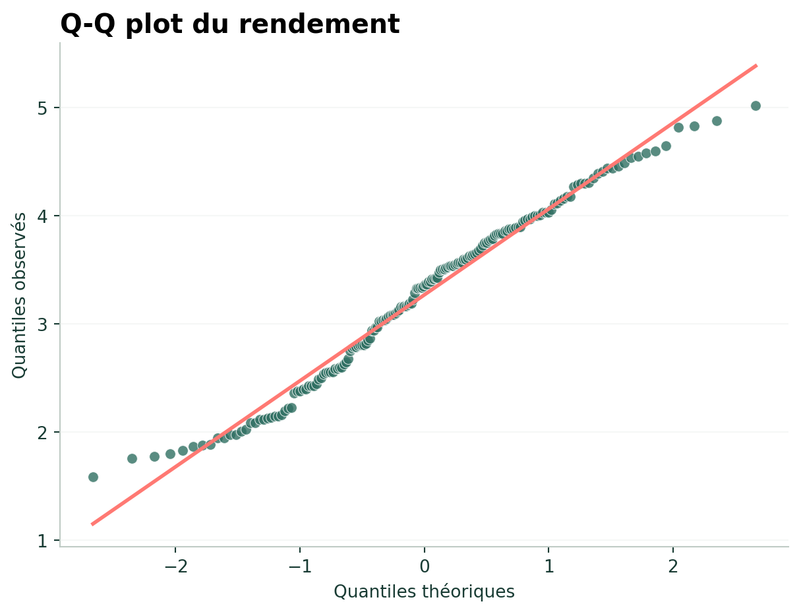
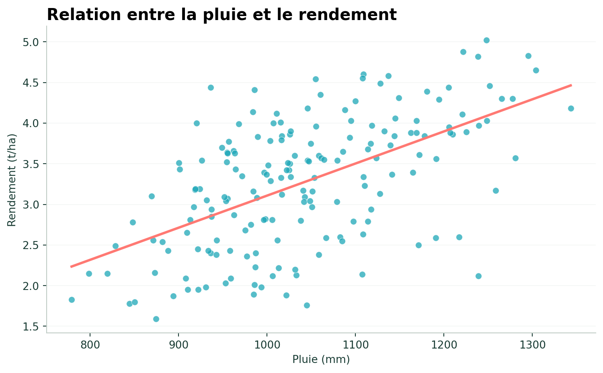
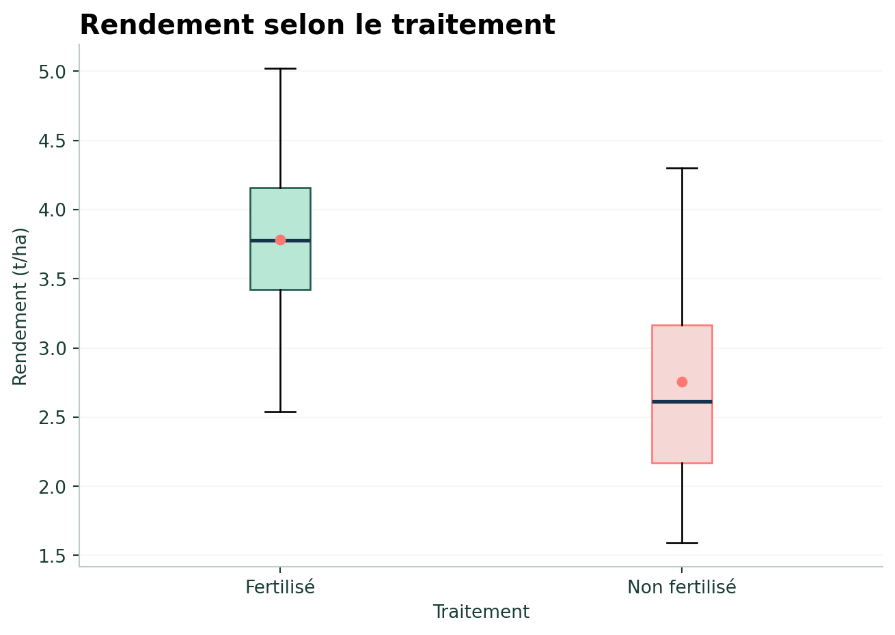
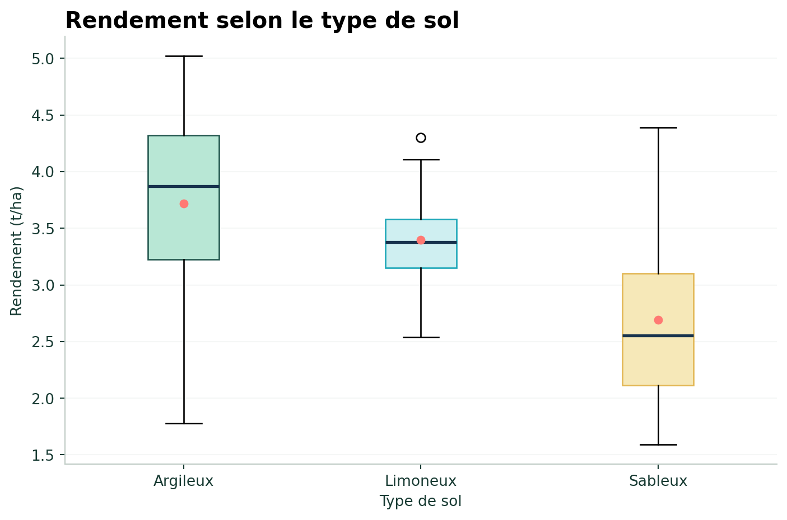
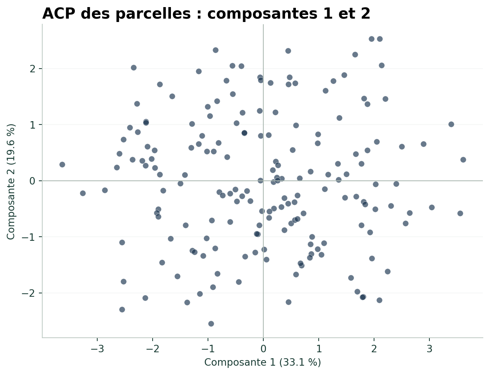

## Jeu de données

Cette partie utilise :

`data/donnees_parcelles_simulees_tests_stats.xlsx`

```{python}
#| eval: false

import pandas as pd
import scipy.stats as stats
import matplotlib.pyplot as plt

df_sim = pd.read_excel(
    "../data/donnees_parcelles_simulees_tests_stats.xlsx"
)
```

::: {.callout-warning}
## Données simulées

Les résultats statistiques de cette section sont utilisés à des fins pédagogiques. Ils ne doivent pas être interprétés comme des résultats agronomiques observés sur le terrain.
:::

::: {.callout-note}
## Visualisation

Tous les graphiques de cette page sont affichés avec Matplotlib.  
[Documentation officielle de Matplotlib](https://matplotlib.org/stable/){target="_blank" rel="noopener"}
:::

## Choisir un test statistique

| Question | Exemple | Méthode |
|---|---|---|
| La variable est-elle normale ? | rendement | Shapiro-Wilk |
| Deux variables numériques sont-elles associées ? | pluie et rendement | Corrélation de Pearson |
| Deux groupes ont-ils des moyennes différentes ? | fertilisé / non fertilisé | Test t |
| Plus de deux groupes diffèrent-ils ? | types de sol | ANOVA |
| Comparer des groupes en contrôlant une variable | sol + pluie | ANCOVA |
| Résumer plusieurs variables quantitatives | propriétés des parcelles | ACP |
| Explorer plusieurs variables qualitatives | région, culture, sol | ACM |

::: {.callout-note}
## Comment utiliser ce tableau ?

Commencez par identifier le **type de variables** et la **question posée**, puis choisissez la méthode adaptée. Les sections suivantes détaillent chaque test et montrent comment l’appliquer avec Python.
:::

# Test de normalité

```{python}
#| eval: false

from scipy.stats import shapiro

stat, p_value = shapiro(
    df_sim["rendement_t_ha"]
)

print("Statistique :", stat)
print("p-value :", p_value)
```

{fig-alt="Q-Q plot du rendement"}

[Documentation Matplotlib — nuage de points](https://matplotlib.org/stable/api/_as_gen/matplotlib.pyplot.scatter.html){target="_blank" rel="noopener"}

# Corrélation

```{python}
#| eval: false

from scipy.stats import pearsonr

r, p_value = pearsonr(
    df_sim["pluie_mm"],
    df_sim["rendement_t_ha"]
)

print("Coefficient :", r)
print("p-value :", p_value)
```

### Visualiser la relation

```{python}
#| eval: false

import numpy as np

x = df_sim["pluie_mm"]
y = df_sim["rendement_t_ha"]

fig, ax = plt.subplots(figsize=(8, 5))

ax.scatter(
    x,
    y,
    color="#1DA7B8",
    alpha=0.75,
    edgecolors="white",
    linewidths=0.4
)

a, b = np.polyfit(x, y, 1)

x_ligne = np.linspace(
    x.min(),
    x.max(),
    100
)

ax.plot(
    x_ligne,
    a * x_ligne + b,
    color="#FF7973",
    linewidth=2.3
)

ax.set_xlabel("Pluie (mm)")
ax.set_ylabel("Rendement (t/ha)")
ax.set_title(
    "Relation entre la pluie et le rendement",
    loc="left",
    fontsize=15,
    fontweight="bold"
)

ax.spines["top"].set_visible(False)
ax.spines["right"].set_visible(False)

plt.tight_layout()
plt.show()
```

{fig-alt="Relation entre pluie et rendement"}

[Documentation Matplotlib — scatter](https://matplotlib.org/stable/api/_as_gen/matplotlib.pyplot.scatter.html){target="_blank" rel="noopener"}

# Test t de Student

```{python}
#| eval: false

rendement_fertilise = df_sim[
    df_sim["traitement"] == "Fertilise"
]["rendement_t_ha"]

rendement_non_fertilise = df_sim[
    df_sim["traitement"] == "Non fertilise"
]["rendement_t_ha"]

stat, p_value = stats.ttest_ind(
    rendement_fertilise,
    rendement_non_fertilise,
    equal_var=False
)
```

{fig-alt="Rendement selon le traitement"}

[Documentation Matplotlib — boxplots](https://matplotlib.org/stable/api/_as_gen/matplotlib.pyplot.boxplot.html){target="_blank" rel="noopener"}

# ANOVA

```{python}
#| eval: false

argileux = df_sim[
    df_sim["type_sol"] == "Argileux"
]["rendement_t_ha"]

limoneux = df_sim[
    df_sim["type_sol"] == "Limoneux"
]["rendement_t_ha"]

sableux = df_sim[
    df_sim["type_sol"] == "Sableux"
]["rendement_t_ha"]

stat, p_value = stats.f_oneway(
    argileux,
    limoneux,
    sableux
)
```

{fig-alt="Rendement selon le type de sol"}

[Documentation Matplotlib — boxplots](https://matplotlib.org/stable/api/_as_gen/matplotlib.pyplot.boxplot.html){target="_blank" rel="noopener"}

# ANCOVA

```{python}
#| eval: false

import statsmodels.api as sm
import statsmodels.formula.api as smf

modele = smf.ols(
    "rendement_t_ha ~ C(type_sol) + pluie_mm",
    data=df_sim
).fit()

table_ancova = sm.stats.anova_lm(
    modele,
    typ=2
)

table_ancova
```

# Analyse en Composantes Principales — ACP

```{python}
#| eval: false

from sklearn.preprocessing import StandardScaler
from sklearn.decomposition import PCA

variables_acp = df_sim[[
    "pluie_mm",
    "temperature_c",
    "surface_ha",
    "ph_sol",
    "matiere_organique_pct",
    "azote_kg_ha",
    "rendement_t_ha"
]]

X = StandardScaler().fit_transform(
    variables_acp
)

pca = PCA(n_components=4)
coordonnees = pca.fit_transform(X)

print(pca.explained_variance_ratio_)
```

### Visualiser les deux premiers axes

```{python}
#| eval: false

fig, ax = plt.subplots(figsize=(7, 5))

ax.scatter(
    coordonnees[:, 0],
    coordonnees[:, 1],
    color="#17324D",
    alpha=0.65,
    edgecolors="white",
    linewidths=0.35
)

ax.axhline(0, color="#AAB7B0", linewidth=0.8)
ax.axvline(0, color="#AAB7B0", linewidth=0.8)

ax.set_xlabel(
    f"Composante 1 ({pca.explained_variance_ratio_[0] * 100:.1f} %)"
)

ax.set_ylabel(
    f"Composante 2 ({pca.explained_variance_ratio_[1] * 100:.1f} %)"
)

ax.set_title(
    "ACP des parcelles : composantes 1 et 2",
    loc="left",
    fontsize=15,
    fontweight="bold"
)

ax.spines["top"].set_visible(False)
ax.spines["right"].set_visible(False)

plt.tight_layout()
plt.show()
```

{fig-alt="ACP des parcelles, composantes 1 et 2"}

[Documentation Matplotlib — scatter](https://matplotlib.org/stable/api/_as_gen/matplotlib.pyplot.scatter.html){target="_blank" rel="noopener"}

# Analyse des Correspondances Multiples — ACM

Les variables qualitatives utilisées sont :

```{python}
#| eval: false

variables_acm = df_sim[[
    "region",
    "culture",
    "traitement",
    "type_sol",
    "fertilite_sol"
]].astype(str)
```

Avec `prince` :

```{python}
#| eval: false

import prince

acm = prince.MCA(
    n_components=3
)

acm = acm.fit(variables_acm)

coordonnees_acm = acm.row_coordinates(
    variables_acm
)
```

<div class="chapter-nav">
[← Traitement et visualisation](03-2-traitement.qmd){.chapter-prev}
[Machine Learning →](04-1-introduction.qmd){.chapter-next}
</div>
