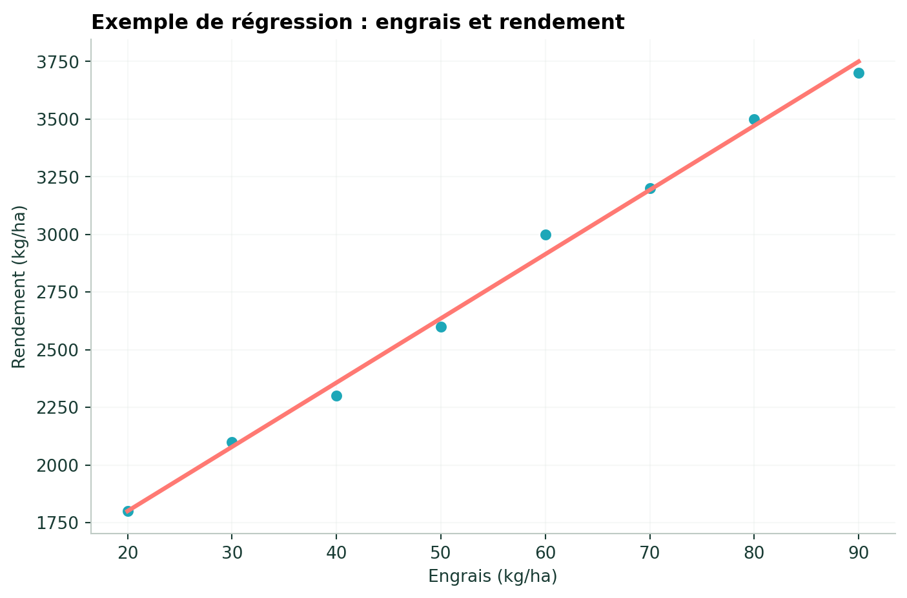
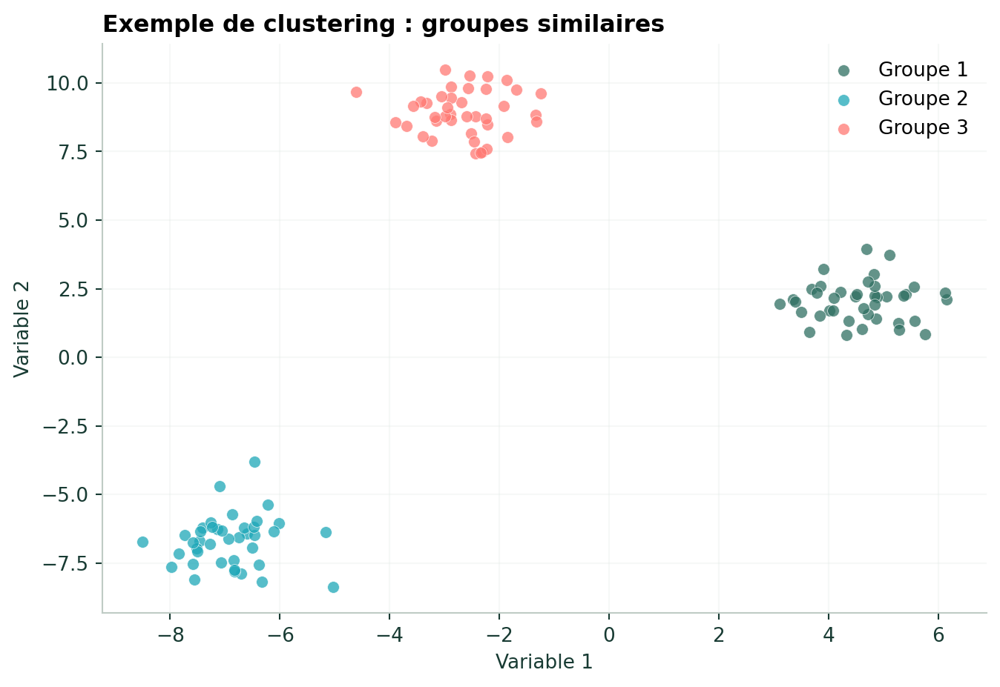
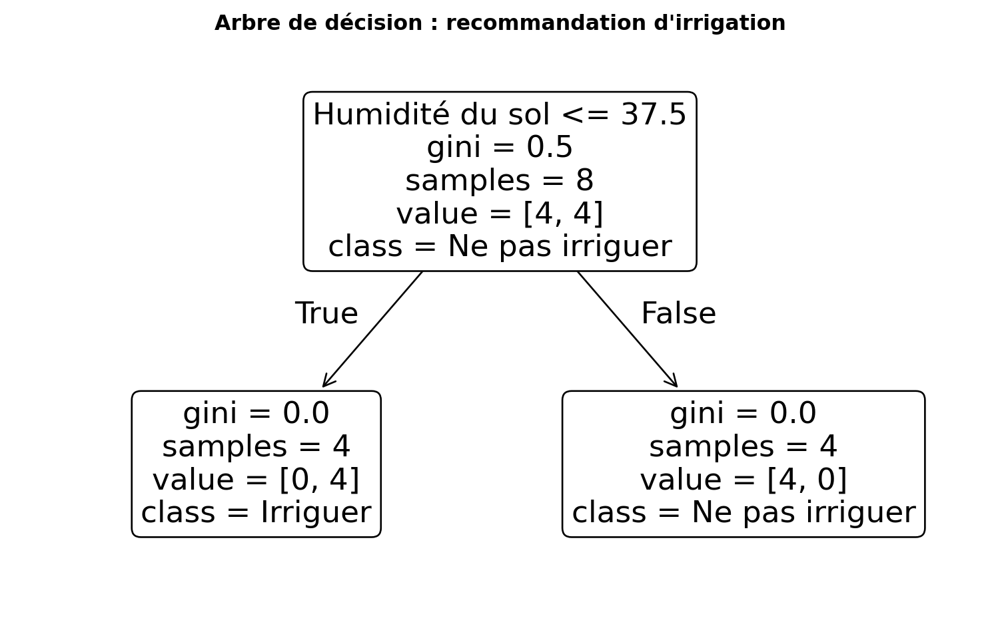

## Comment choisir un type de modèle ?

La première question est : **avons-nous une variable cible ?**

| Situation | Type de problème | Exemples |
|---|---|---|
| Cible numérique | Régression | rendement, besoin en eau, production |
| Cible catégorielle | Classification | saine/malade, risque faible/élevé |
| Pas de cible | Clustering | groupes d'exploitations similaires |

## Régression

La régression est utilisée lorsque la variable cible est **numérique continue**.

{fig-alt="Exemple de régression entre quantité d'engrais et rendement"}

Exemples agricoles :

- prédire le rendement ;
- estimer la production ;
- prévoir les besoins en eau.

## Classification

La classification est utilisée lorsque la cible correspond à une **catégorie**.

{fig-alt="Exemple de classification de plantes saines et malades"}

Exemples :

- plante saine / malade ;
- fruit mûr / non mûr ;
- parcelle à risque / sans risque.

## Clustering

Le clustering appartient à l'apprentissage non supervisé.

{fig-alt="Exemple de clustering en trois groupes"}

Il peut servir à regrouper des exploitations ou des parcelles présentant des profils similaires.

## Arbre de décision

Un arbre de décision effectue une succession de questions.

{fig-alt="Arbre de décision pour une recommandation d'irrigation"}

Exemple :

```text
Humidité du sol < seuil ?
          ↓
      oui / non
          ↓
Irriguer / Ne pas irriguer
```

## Random Forest

Un **Random Forest** combine plusieurs arbres de décision. Chaque arbre produit une prédiction, puis les résultats sont combinés.

Cette approche est utilisée dans les exercices suivants pour prédire le rendement agricole.

## Quel algorithme pour quelle question ?

| Question agricole | Type | Algorithmes possibles |
|---|---|---|
| Quel sera le rendement ? | Régression | Régression linéaire, Random Forest |
| La plante est-elle malade ? | Classification | Régression logistique, arbre de décision |
| Faut-il irriguer ? | Classification | Arbre de décision, Random Forest |
| Quels profils de parcelles existent ? | Clustering | K-means |

<div class="chapter-nav">
[← Introduction](04-1-introduction.qmd){.chapter-prev}
[Régression logistique →](04-3-logistique.qmd){.chapter-next}
</div>
