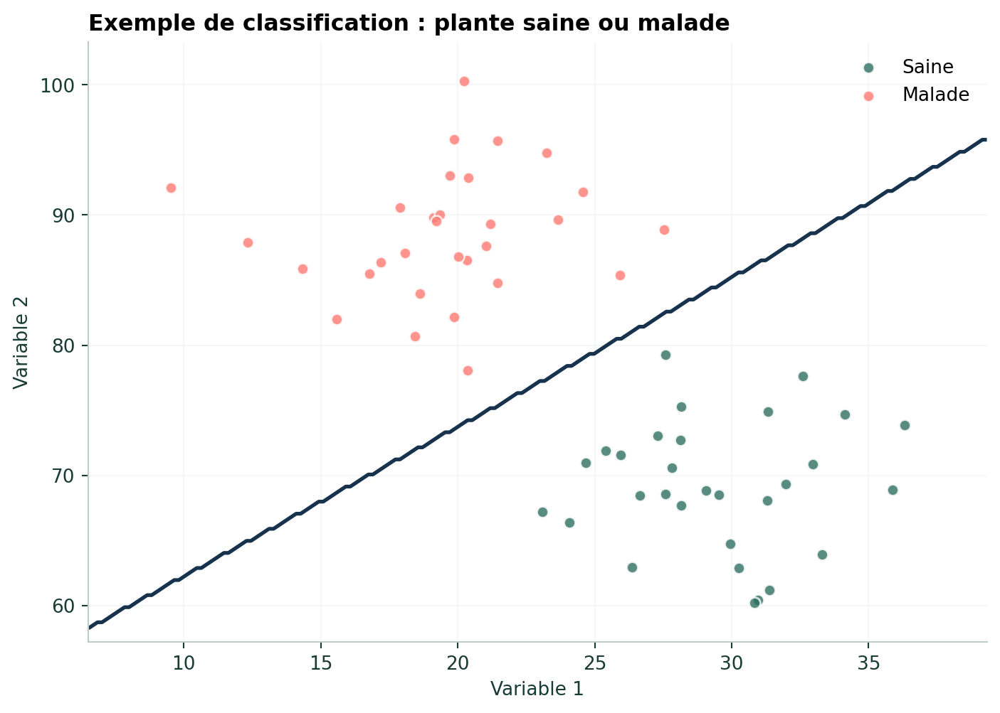

## Objectif

La **régression logistique** est un algorithme de classification. Elle est utilisée lorsque la variable cible possède deux catégories.

Dans l'exemple pédagogique du notebook, nous cherchons à distinguer deux groupes :

- plante saine ;
- plante malade.

::: {.callout-warning}
## Exemple pédagogique

Les données de cette démonstration sont générées artificiellement dans le notebook d'introduction. Elles illustrent le fonctionnement de la classification et ne constituent pas un diagnostic phytosanitaire réel.
:::

## Préparer les données

```{python}
#| eval: false

import numpy as np

np.random.seed(42)

saines = np.random.normal(
    [30, 70],
    [4, 5],
    size=(30, 2)
)

malades = np.random.normal(
    [20, 88],
    [4, 5],
    size=(30, 2)
)

X = np.vstack([saines, malades])

y = np.array(
    [0] * 30 +
    [1] * 30
)
```

## Entraîner le modèle

```{python}
#| eval: false

from sklearn.linear_model import LogisticRegression

modele = LogisticRegression()

modele.fit(X, y)
```

## Visualiser la classification

{fig-alt="Classification pédagogique entre plantes saines et malades"}

## Interpréter

Le modèle apprend une frontière permettant de séparer les deux catégories à partir des variables fournies.

Dans une application réelle, les variables pourraient provenir de mesures de terrain, d'images, de capteurs ou de données climatiques. Les données réelles nécessiteraient toutefois une validation agronomique et phytosanitaire.

## Étape suivante

Un modèle de classification doit être évalué sur des données non utilisées pour l'entraînement. Une métrique simple est la **matrice de confusion**, présentée dans le cas pratique de diagnostic des plantes.

<div class="chapter-nav">
[← Types d'algorithmes](04-2-algorithmes.qmd){.chapter-prev}
[Random Forest →](04-4-random-forest.qmd){.chapter-next}
</div>
