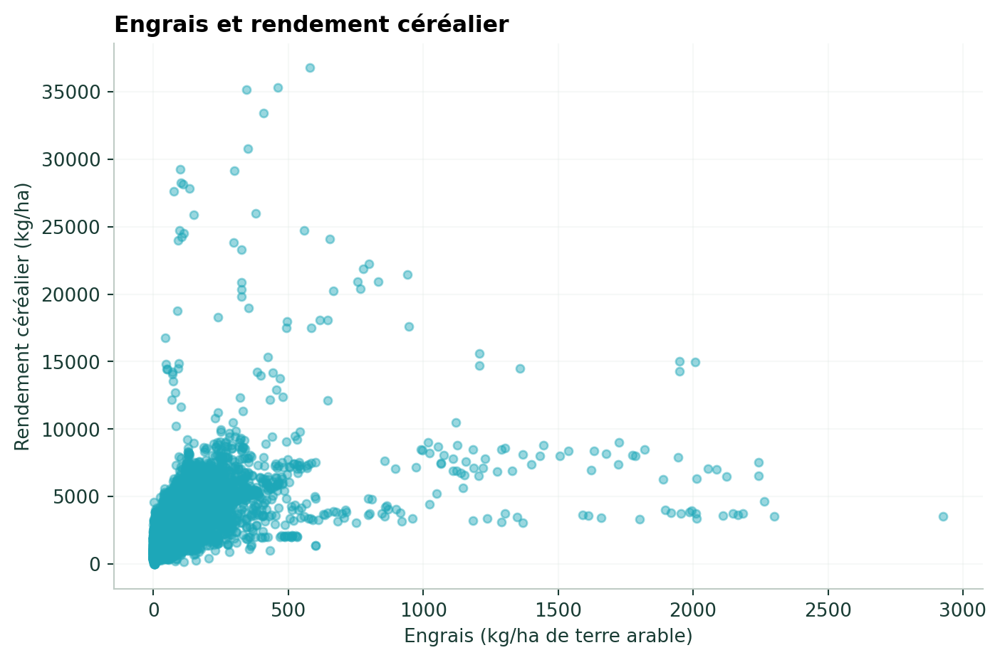
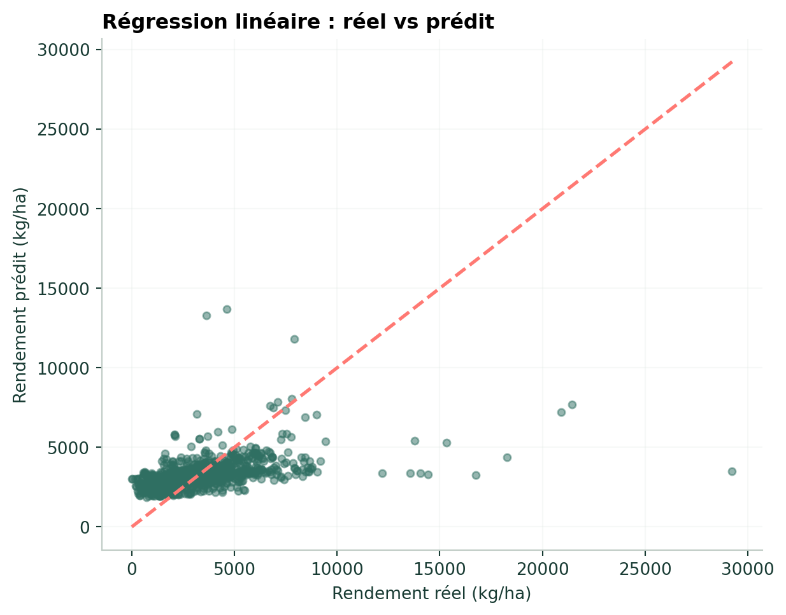
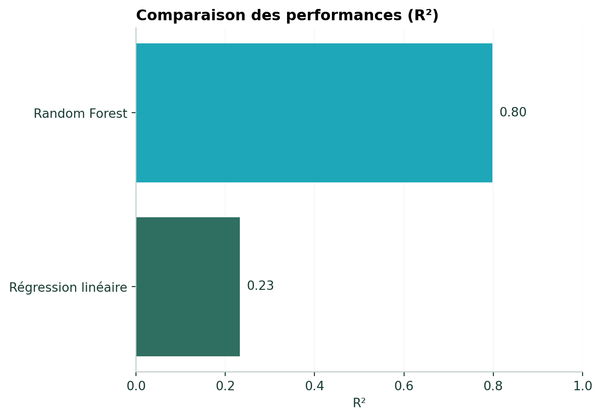
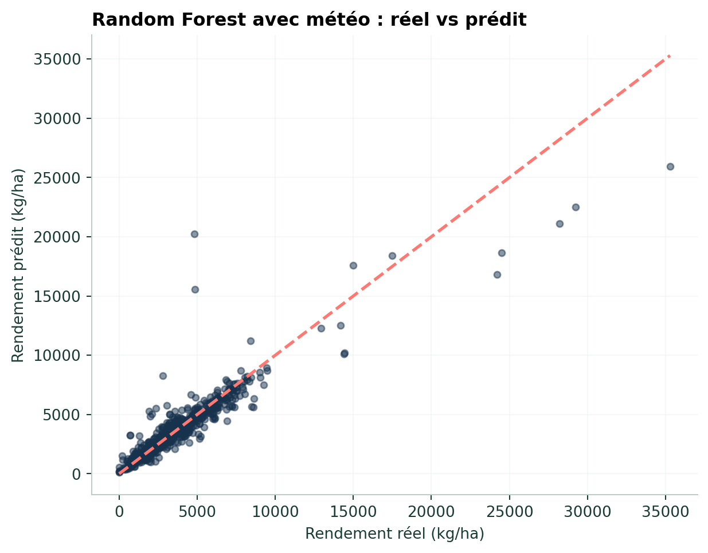
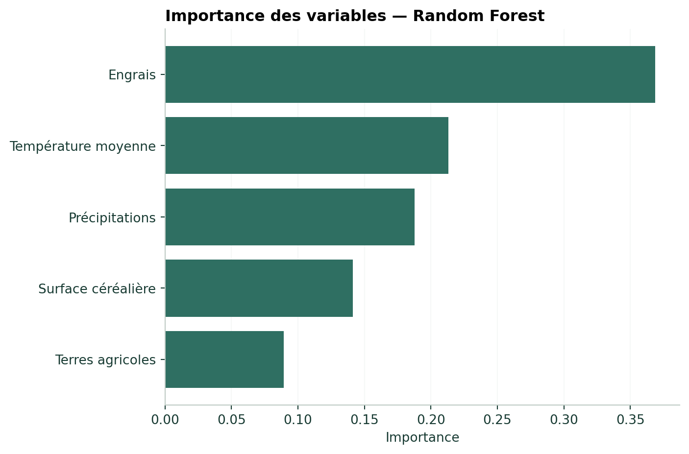

## Objectif

Cette partie reprend les deux exercices Machine Learning fournis.

Le premier jeu de données contient **5 310 observations** et utilise trois variables agricoles pour prédire le rendement céréalier. Le second ajoute la température moyenne et les précipitations.

## Jeu de données 1 — Variables agricoles

```{python}
#| eval: false

import pandas as pd

df_ml = pd.read_excel(
    "../data/donnees_agricoles_machine_learning.xlsx"
)

df_ml.shape
```

Variables utilisées :

```{python}
#| eval: false

features = [
    "engrais_kg_ha",
    "surface_cereales_ha",
    "terres_agricoles_pct"
]

X = df_ml[features]
y = df_ml["rendement_kg_ha"]
```

{fig-alt="Relation entre engrais et rendement céréalier"}

## Modèle de référence — Régression linéaire

```{python}
#| eval: false

from sklearn.model_selection import train_test_split
from sklearn.linear_model import LinearRegression
from sklearn.metrics import mean_absolute_error, r2_score

X_train, X_test, y_train, y_test = train_test_split(
    X,
    y,
    test_size=0.2,
    random_state=42
)

modele = LinearRegression()
modele.fit(X_train, y_train)

predictions = modele.predict(X_test)

mae = mean_absolute_error(y_test, predictions)
r2 = r2_score(y_test, predictions)
```

Résultats obtenus dans le notebook :

- **MAE : 1347.9 kg/ha**
- **R² : 0.232**

{fig-alt="Rendements réels et prédits avec la régression linéaire"}

## Random Forest

```{python}
#| eval: false

from sklearn.ensemble import RandomForestRegressor

modele_rf = RandomForestRegressor(
    n_estimators=200,
    random_state=42,
    n_jobs=-1
)

modele_rf.fit(
    X_train,
    y_train
)

y_pred_rf = modele_rf.predict(
    X_test
)
```

Évaluation :

```{python}
#| eval: false

mae_rf = mean_absolute_error(
    y_test,
    y_pred_rf
)

r2_rf = r2_score(
    y_test,
    y_pred_rf
)

print("MAE :", mae_rf)
print("R² :", r2_rf)
```

Résultats du notebook :

- **MAE : 456.1 kg/ha**
- **R² : 0.799**

{fig-alt="Comparaison du R carré entre régression linéaire et Random Forest"}

Le Random Forest améliore nettement les performances sur ce jeu de données par rapport à la régression linéaire utilisée comme modèle de référence.

# Exemple 2 — Ajout des données météorologiques

Le deuxième fichier ajoute :

- `temperature_moyenne`
- `precipitations_mm`

```{python}
#| eval: false

df_ml2 = pd.read_excel(
    "../data/donnees_agricoles_meteo_machine_learning.xlsx"
)

features = [
    "engrais_kg_ha",
    "surface_cereales_ha",
    "terres_agricoles_pct",
    "temperature_moyenne",
    "precipitations_mm"
]

X = df_ml2[features]
y = df_ml2["rendement_kg_ha"]
```

Après séparation des données et entraînement du Random Forest, le notebook obtient :

- **MAE : 472.7 kg/ha**
- **R² : 0.859**

{fig-alt="Rendements réels et prédits par le Random Forest avec variables météo"}

## Importance des variables

```{python}
#| eval: false

importance = pd.Series(
    modele_rf.feature_importances_,
    index=features
).sort_values(
    ascending=False
)

importance
```

{fig-alt="Importance des variables du modèle Random Forest avec données météorologiques"}

Dans le notebook, les importances obtenues sont environ :

| Variable | Importance |
|---|---:|
| Engrais | 0,368 |
| Température moyenne | 0,213 |
| Précipitations | 0,187 |
| Surface céréalière | 0,142 |
| Terres agricoles | 0,090 |

::: {.callout-note}
## Interprétation

L'importance d'une variable indique sa contribution au modèle Random Forest. Elle ne doit pas être interprétée automatiquement comme un effet causal sur le rendement.
:::

<div class="chapter-nav">
[← Régression logistique](04-3-logistique.qmd){.chapter-prev}
[Diagnostic des plantes →](04-5-diagnostic-plantes.qmd){.chapter-next}
</div>
