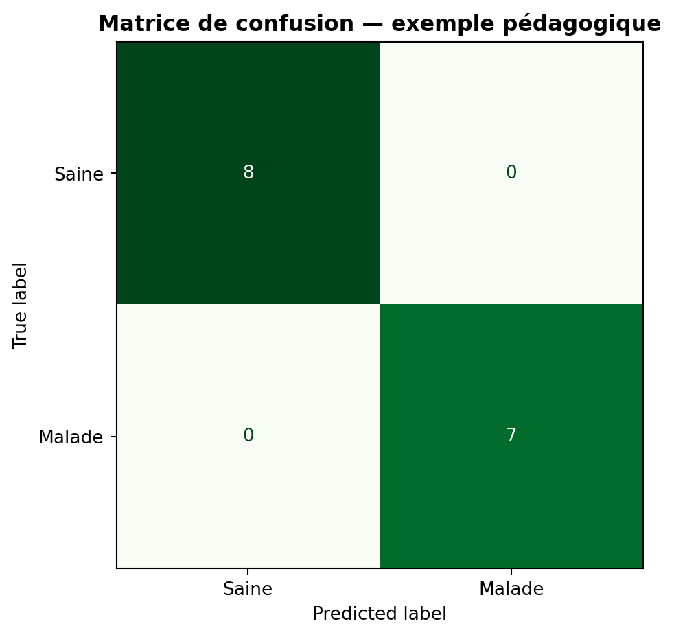

## Objectif

Cette page reprend l'exemple de classification du notebook d'introduction afin d'illustrer le cheminement d'un problème de diagnostic :

```text
Observations
    ↓
Variables X
    ↓
Classe cible y
    ↓
Entraînement
    ↓
Prédiction
    ↓
Évaluation
```

::: {.callout-warning}
## Limite de l'exemple

Les données utilisées ici sont synthétiques. Ce cas pratique sert uniquement à comprendre la logique d'un modèle de classification. Il ne constitue pas un outil réel de diagnostic des maladies des plantes.
:::

## 1. Définir la cible

Dans cet exemple :

```text
0 = plante saine
1 = plante malade
```

## 2. Séparer entraînement et test

```{python}
#| eval: false

from sklearn.model_selection import train_test_split

X_train, X_test, y_train, y_test = train_test_split(
    X,
    y,
    test_size=0.25,
    random_state=42,
    stratify=y
)
```

## 3. Entraîner la régression logistique

```{python}
#| eval: false

from sklearn.linear_model import LogisticRegression

modele = LogisticRegression()

modele.fit(
    X_train,
    y_train
)
```

## 4. Produire les prédictions

```{python}
#| eval: false

predictions = modele.predict(
    X_test
)
```

## 5. Évaluer avec une matrice de confusion

```{python}
#| eval: false

from sklearn.metrics import confusion_matrix

matrice = confusion_matrix(
    y_test,
    predictions
)

print(matrice)
```

{fig-alt="Matrice de confusion du modèle de classification pédagogique"}

La matrice de confusion permet de distinguer :

- les plantes saines correctement classées ;
- les plantes malades correctement classées ;
- les erreurs de classification.

## Pour aller vers un diagnostic réel

Le notebook fourni ne contient pas de jeu de données phytosanitaire réel. Pour transformer cet exemple en application scientifique, il faudrait notamment disposer de données étiquetées et validées, puis construire un protocole de validation adapté.

::: {.callout-tip}
## À retenir

Un modèle de classification ne doit pas être évalué uniquement sur les données utilisées pour l'entraînement. La validation sur des observations séparées est essentielle.
:::

<div class="chapter-nav">
[← Random Forest](04-4-random-forest.qmd){.chapter-prev}
[Analyse géospatiale →](05-1-qgis.qmd){.chapter-next}
</div>
