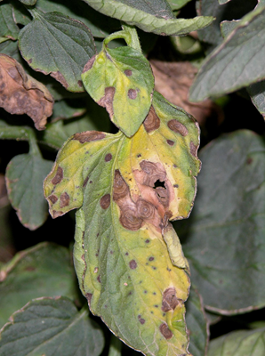
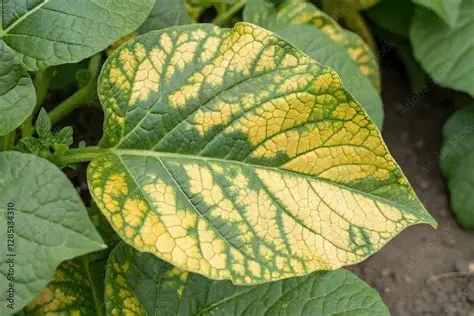
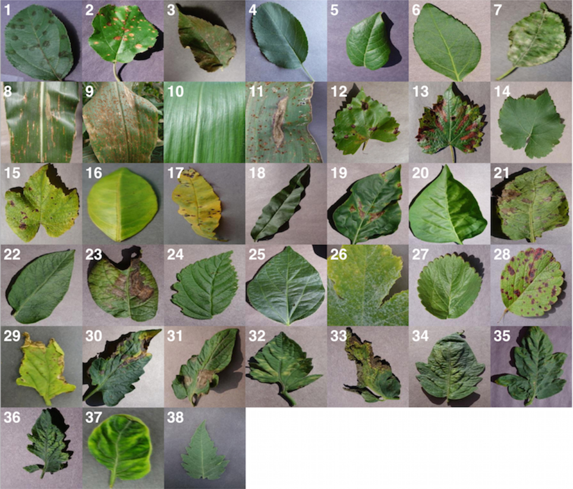
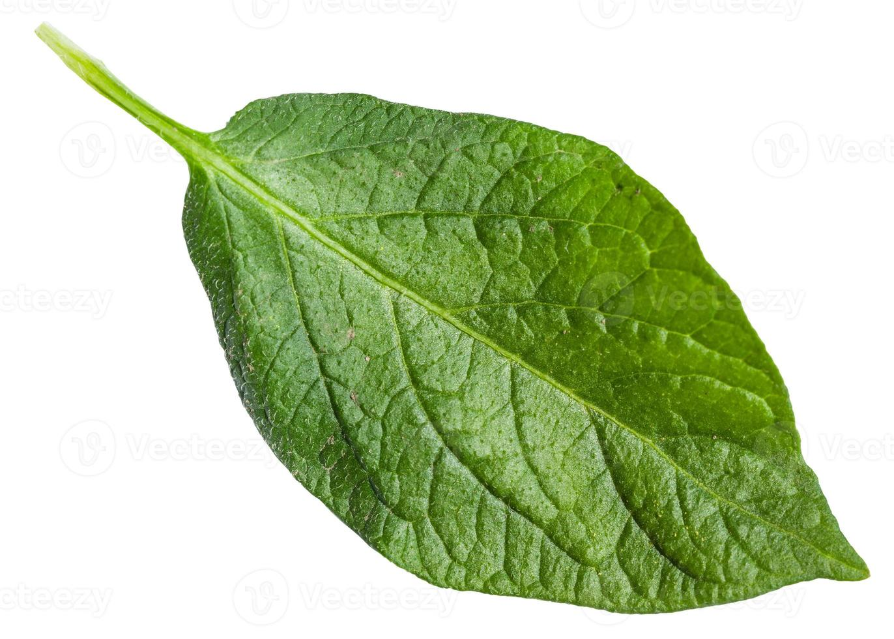

## Objectif du cas pratique

Dans ce cas pratique, nous utilisons des **images de feuilles de pomme de terre** pour illustrer un problème de classification en Machine Learning.

L'objectif est de construire un modèle capable de distinguer plusieurs états de la feuille à partir d'informations extraites des images.

Les trois classes utilisées dans le notebook sont :

- `Healthy` : feuille saine ;
- `Early_blight` : mildiou précoce ;
- `Late_blight` : mildiou tardif.

::: {.callout-note}
## Source du jeu de données

Les images utilisées pour constituer le jeu de données proviennent du **PlantVillage Dataset**.

[Consulter et télécharger le PlantVillage Dataset sur GitHub](https://github.com/spmohanty/plantvillage-dataset){target="_blank" rel="noopener"}

Le dépôt contient une collection d'images de feuilles saines et malades utilisées dans de nombreux travaux pédagogiques et expérimentaux sur la reconnaissance des maladies des plantes.
:::

## Comprendre le problème

Le principe général est le suivant :

```text
Images de feuilles
        ↓
Préparation des images
        ↓
Extraction de caractéristiques
        ↓
Variables X
        ↓
Classe y
        ↓
Entraînement du Random Forest
        ↓
Prédiction
        ↓
Évaluation
```

L'objectif n'est donc pas simplement d'afficher une image, mais de transformer chaque image en informations numériques pouvant être utilisées par un algorithme de Machine Learning.

## Exemples visuels

### Feuille saine

{fig-alt="Exemple de feuille saine utilisée pour illustrer la classe Healthy"}

Une feuille saine présente une coloration relativement homogène et ne montre pas de lésions importantes visibles.

### Feuille présentant des symptômes

{fig-alt="Exemple de feuille présentant des lésions foliaires"}

Les feuilles malades peuvent présenter des taches brunes, des zones nécrotiques, un jaunissement ou d'autres modifications de couleur et de texture.

### Autre exemple de feuille

{fig-alt="Exemple de feuille présentant un jaunissement"}

Ces variations visuelles constituent des informations que l'on peut tenter de représenter par des variables numériques.

## Vue d'ensemble du type de données

{fig-alt="Exemples de feuilles saines et malades issues de différentes classes"}

Un jeu d'images peut contenir une grande diversité de formes, de couleurs et de symptômes. Le modèle doit apprendre à distinguer les classes à partir des exemples fournis pendant l'entraînement.

---


## Exemples de diversité dans le jeu de données

L'image ci-dessous illustre la diversité des feuilles et des symptômes pouvant apparaître dans un jeu de données de diagnostic végétal.

{fig-alt="Mosaïque de feuilles saines et malades illustrant la diversité des classes du jeu de données PlantVillage" fig-cap="Exemples de feuilles présentant différents états sanitaires et symptômes visuels."}

Cette diversité visuelle montre pourquoi un modèle doit apprendre à distinguer plusieurs combinaisons de couleur, texture, forme et lésions foliaires plutôt que de se baser sur un seul symptôme.

## 1. Organiser les images

Dans le notebook, les images sont organisées par classe.

Une structure typique peut être :

```text
dataset/
├── Healthy/
├── Early_blight/
└── Late_blight/
```

Chaque dossier contient des images correspondant à une classe.

---

## 2. Charger et préparer une image

Avant d'utiliser une image dans le modèle, on doit la lire et la transformer en un format cohérent.

Exemple :

```{python}
#| eval: false

from PIL import Image
import numpy as np

image = Image.open("chemin/vers/image.jpg")
image = image.convert("RGB")
image = image.resize((256, 256))

image_array = np.array(image)
```

La conversion en `RGB` garantit que chaque image possède trois canaux de couleur :

- rouge ;
- vert ;
- bleu.

---

## 3. Extraire des caractéristiques

Un Random Forest ne traite pas directement l'image comme un réseau de neurones convolutionnel.

Il faut d'abord transformer l'image en variables numériques.

Par exemple, on peut calculer des caractéristiques basées sur les valeurs des canaux RGB :

```{python}
#| eval: false

moyenne_rouge = image_array[:, :, 0].mean()
moyenne_vert = image_array[:, :, 1].mean()
moyenne_bleu = image_array[:, :, 2].mean()
```

Ces variables résument une partie de l'information contenue dans l'image.

::: {.callout-note}
## Principe

L'image est transformée en une ligne de données :

```text
Image → caractéristiques numériques → modèle
```

C'est cette représentation numérique qui est utilisée par le Random Forest.
:::

---

## 4. Construire les variables `X` et `y`

`X` contient les caractéristiques extraites des images.

`y` contient la classe de chaque feuille.

```{python}
#| eval: false

X = donnees_caracteristiques
y = classes
```

Exemple :

```text
Healthy       → 0
Early_blight  → 1
Late_blight   → 2
```

---

## 5. Séparer les données

Il est important de ne pas évaluer le modèle uniquement sur les images utilisées pour l'entraînement.

```{python}
#| eval: false

from sklearn.model_selection import train_test_split

X_train, X_test, y_train, y_test = train_test_split(
    X,
    y,
    test_size=0.25,
    random_state=42,
    stratify=y
)
```

On obtient alors :

- un jeu d'entraînement ;
- un jeu de test.

---

## 6. Entraîner le Random Forest

```{python}
#| eval: false

from sklearn.ensemble import RandomForestClassifier

modele = RandomForestClassifier(
    n_estimators=200,
    random_state=42
)

modele.fit(
    X_train,
    y_train
)
```

Le modèle apprend à associer les caractéristiques numériques des images aux différentes classes.

---

## 7. Faire des prédictions

```{python}
#| eval: false

predictions = modele.predict(
    X_test
)
```

Chaque image du jeu de test reçoit alors une classe prédite.

---

## 8. Évaluer le modèle

### Accuracy

```{python}
#| eval: false

from sklearn.metrics import accuracy_score

accuracy = accuracy_score(
    y_test,
    predictions
)

print("Accuracy :", accuracy)
```

Dans le notebook de cours, un exemple d'exécution obtient environ **86,7 % d'accuracy**, soit **65 images correctement classées sur 75**.

::: {.callout-warning}
## Interprétation

Cette valeur dépend du jeu de données, de la séparation train/test, des caractéristiques extraites et des paramètres du modèle.

Une bonne accuracy ne signifie pas nécessairement que toutes les classes sont aussi bien reconnues.
:::

### Rapport de classification

```{python}
#| eval: false

from sklearn.metrics import classification_report

print(
    classification_report(
        y_test,
        predictions
    )
)
```

Le rapport permet d'examiner les performances par classe.

Dans l'exemple du notebook, la classe `Late_blight` est la plus difficile à distinguer.

---

## 9. Matrice de confusion

```{python}
#| eval: false

from sklearn.metrics import confusion_matrix

matrice = confusion_matrix(
    y_test,
    predictions
)

print(matrice)
```

La matrice de confusion permet d'identifier :

- les images correctement classées ;
- les confusions entre `Healthy`, `Early_blight` et `Late_blight` ;
- les classes pour lesquelles le modèle rencontre le plus de difficultés.

---

## 10. Importance des variables

Le Random Forest permet également d'examiner l'importance des caractéristiques utilisées.

```{python}
#| eval: false

importances = modele.feature_importances_

print(importances)
```

Cela permet d'identifier quelles caractéristiques numériques contribuent le plus aux décisions du modèle.

::: {.callout-note}
## Attention

L'importance d'une variable indique son utilité dans le modèle. Elle ne prouve pas qu'elle est biologiquement responsable de la maladie.
:::

---

## 11. Tester une nouvelle feuille

Une fois le modèle entraîné, on peut préparer une nouvelle image avec exactement la même procédure.

{fig-alt="Nouvelle feuille pouvant être utilisée pour tester le modèle"}

Le workflow devient :

```text
Nouvelle image
      ↓
Redimensionnement
      ↓
Extraction des mêmes caractéristiques
      ↓
Random Forest
      ↓
Classe prédite
```

Exemple :

```{python}
#| eval: false

nouvelle_prediction = modele.predict(
    caracteristiques_nouvelle_image
)

print(nouvelle_prediction)
```

---

## Limites et bonnes pratiques

Ce cas pratique montre comment construire une première chaîne de classification d'images avec un Random Forest.

Pour une application scientifique ou opérationnelle, il faudrait notamment :

- disposer d'un jeu de données représentatif des conditions locales ;
- vérifier la qualité des étiquettes ;
- utiliser suffisamment d'images pour chaque classe ;
- tester le modèle sur des données indépendantes ;
- analyser les erreurs de classification ;
- faire valider l'interprétation par des spécialistes du domaine.

::: {.callout-tip}
## Points à retenir

- Une image doit être transformée en informations numériques pour être utilisée par un Random Forest.
- Le jeu de données contient plusieurs classes de feuilles.
- Les données doivent être séparées entre entraînement et test.
- La matrice de confusion permet d'identifier les types d'erreurs.
- Une accuracy globale doit toujours être complétée par une analyse des performances par classe.
- Les résultats du modèle doivent être interprétés avec prudence dans un contexte agronomique réel.
:::

## Ressource

[PlantVillage Dataset — GitHub](https://github.com/spmohanty/plantvillage-dataset){target="_blank" rel="noopener"}

<div class="chapter-nav">

[← Random Forest](04-4-random-forest.qmd){.chapter-prev}

[Analyse géospatiale →](05-1-qgis.qmd){.chapter-next}

</div>
